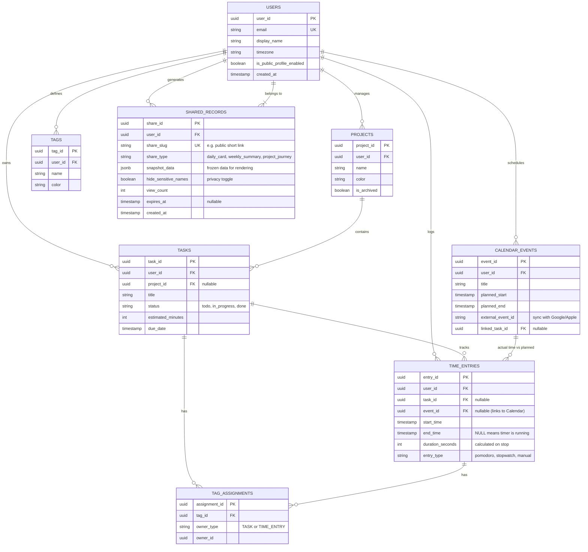

### 文档 3：LifeOS_ER_Diagram_V2.md (数据库 ER 图)

_核心变更：化繁为简，重构为以 `TIME_ENTRIES` (时间日志) 和 `SHARED_RECORDS` (分享记录) 为核心的表结构。完美支持计划与实际比对。_

````markdown
# LifeOS V2 — 数据库 ER 图 (核心实体)

## 1. 核心设计说明

- **Intent vs Reality 分离**：`CALENDAR_EVENTS` 代表计划（例如：下午2点开会），`TIME_ENTRIES` 代表现实（例如：下午2:15才开始，3:00结束）。两者通过 `event_id` 关联。
- **社交分享层**：新增 `SHARED_RECORDS` 表，记录每次生成的分享快照及其隐私设置，用于公共 URL 的访问和数据统计。
- **正在运行的计时器**：不直接高频写库，仅记录 `start_time` 且 `end_time` 为 NULL，配合 Redis 缓存在客户端实时计算跳秒。

## 2. Mermaid ER 图


````

```
flowchart TB
    subgraph ClientLayer ["核心客户端 (React + Tauri + Expo)"]
        direction LR
        LocalDB[(SQLite 本地库)]
        UI["UI 层 (Zustand 状态)"]
        UI <-->|极速读写| LocalDB
    end

    subgraph SyncAndAuth ["BaaS 基础设施 (Serverless)"]
        Clerk["Clerk Auth\n(身份认证)"]
        PowerSync["PowerSync 桥接层\n(监听 Neon WAL)"]
        PartyKit["PartyKit / Pusher\n(WebSocket 计时器心跳)"]
    end

    subgraph DataLayer ["数据与分享 (云端)"]
        Neon[(Neon Serverless Postgres)]
        NextJS["Next.js /share\n(Vercel Edge)"]
        Satori["Satori\n(海报生成)"]
    end

    %% 认证与本地数据库同步
    UI -->|获取 Token| Clerk
    LocalDB <-->|断网恢复 / 增量同步| PowerSync
    PowerSync <-->|逻辑复制流 (Replication)| Neon

    %% 毫秒级时钟同步
    UI <-->|开始/停止 计时信号| PartyKit

    %% 分享页面工作流 (SEO端)
    NextJS -->|直连查询只读数据| Neon
    NextJS -->|动态生成图片| Satori
```
